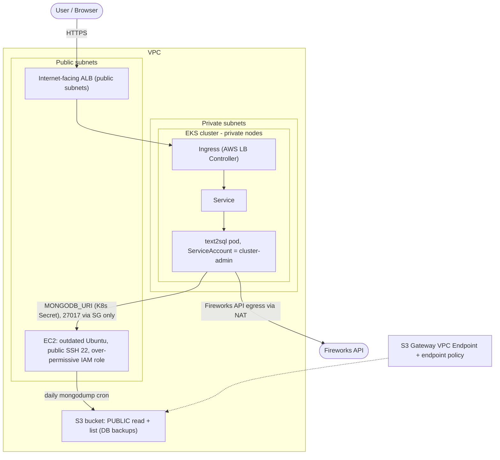

# Wiz Technical Exercise - Text-to-SQL on AWS

A two-tier, containerized **text-to-SQL agent** deployed to **AWS EKS**, backed by
**MongoDB** on an EC2 VM, built and shipped through two secured **CI/CD pipelines**,
and wrapped in native **AWS security controls**. The environment contains the
exercise's required *intentional* weaknesses - each one paired with a control that
detects or prevents it, so the whole build tells one attacker-vs-defender story.

> Name file requirement: [`wizexercise.txt`](wizexercise.txt) is baked into the image
> and validated in the running pod (see the demo script).

## The product (not just a demo app)

An interactive **text-to-SQL** web app: a user signs up, **uploads a `.db` (SQLite)
file**, and asks questions in natural language. The agent grounds every prompt in the
live database schema, returns a single **read-only** `SELECT`, self-corrects on error,
and renders the SQL + results. It genuinely uses **MongoDB** for users, the uploaded-DB
registry, and query history - which is also how we satisfy the exercise's "the app
must leverage MongoDB, with the connection string injected as a Kubernetes env var."

Two databases, two jobs:
- **MongoDB** (on the VM) = the app's own system-of-record (users, uploads, history).
- **SQLite** (uploaded per user) = the analytics target the agent queries.

## Architecture



## Repository layout

```
.
├── app/                 # Text-to-SQL web app (FastAPI) + reused agent (src/)
│   ├── src/             # agent, schema grounding, read-only SQL guard, config, utils
│   ├── web/             # FastAPI app: auth, mongo, upload hardening, UI
│   ├── tests/           # unit + security test matrix
│   └── Dockerfile       # multi-stage build; bakes in wizexercise.txt
├── infra/               # Terraform: VPC, EKS, EC2 Mongo VM, S3, IAM, ECR, CloudTrail, Config, GuardDuty
├── k8s/                 # Deployment, Service, Ingress, SA + cluster-admin binding, Secret template
├── security/
│   ├── kyverno/         # preventative admission control (enforce mode)
│   └── attack-simulation/  # scripts that trip the detective controls
├── .github/workflows/   # infra.yml (IaC pipeline) + app.yml (build/scan/deploy pipeline)
├── docs/                # design notes: decisions, attack path, requirements, scanner findings
└── wizexercise.txt      # baked into the image
```

## Intentional weaknesses (required) and the control that catches each

- **Public-readable + listable S3 bucket** holding DB backups -> AWS Config
  `s3-bucket-public-read-prohibited` (detective) + `tfsec`/`checkov` flag it pre-deploy.
- **EC2 VM with SSH open to `0.0.0.0/0`** -> AWS Config `restricted-ssh` + GuardDuty
  `SSHBruteForce` (detective); caught by IaC scan pre-deploy.
- **Over-permissive VM instance role** (admin) -> CloudTrail + GuardDuty on anomalous
  use; IaC scan flags the wildcard policy.
- **Outdated Linux + outdated MongoDB** -> image/host CVEs; the story's "keeping up with
  security news" thread.
- **Container runs as cluster-admin** -> Kyverno preventative policy demonstrates
  blocking the *class* of risk on new workloads; RBAC review in the demo.

See [`docs/OVERVIEW.md`](docs/OVERVIEW.md) for the design decisions, attack path,
requirements mapping and scanner findings.

## Quick start (local)

```bash
cd app
cp .env.example .env            # set FIREWORKS_API_KEY; MONGODB_URI defaults to localhost
docker run -d -p 27017:27017 --name mongo mongo:7   # or any reachable MongoDB
pip install -e .                # or: uv pip install -e .
uvicorn web.main:app --reload --port 8080
# open http://localhost:8080  -> sign up -> upload data/Chinook.db -> ask a question
```

## Deploy (AWS)

Two pipelines do this in CI, but the manual path is:

```bash
cd infra
terraform init && terraform apply           # VPC, EKS, Mongo VM, S3, IAM, audit/detective controls
$(terraform output -raw configure_kubectl)  # point kubectl at the cluster
./bootstrap-addons.sh                       # AWS Load Balancer Controller + Kyverno policies
cd ..

# Build/push happens in CI; manually: push to ECR, then deploy by digest.
MONGODB_URI=$(terraform -chdir=infra output -raw mongodb_uri) \
APP_SECRET_KEY=$(openssl rand -hex 32) FIREWORKS_API_KEY=fw_... \
  scripts/deploy-app.sh <account>.dkr.ecr.us-east-1.amazonaws.com/text2sql-app@sha256:<digest>

kubectl -n text2sql exec deploy/text2sql -- cat /app/wizexercise.txt   # prove the name file
```

Design notes: [`docs/OVERVIEW.md`](docs/OVERVIEW.md).

> This environment is intentionally insecure for a security exercise. Do not deploy it
> in a production account or leave it running. Tear down with `terraform destroy`.
