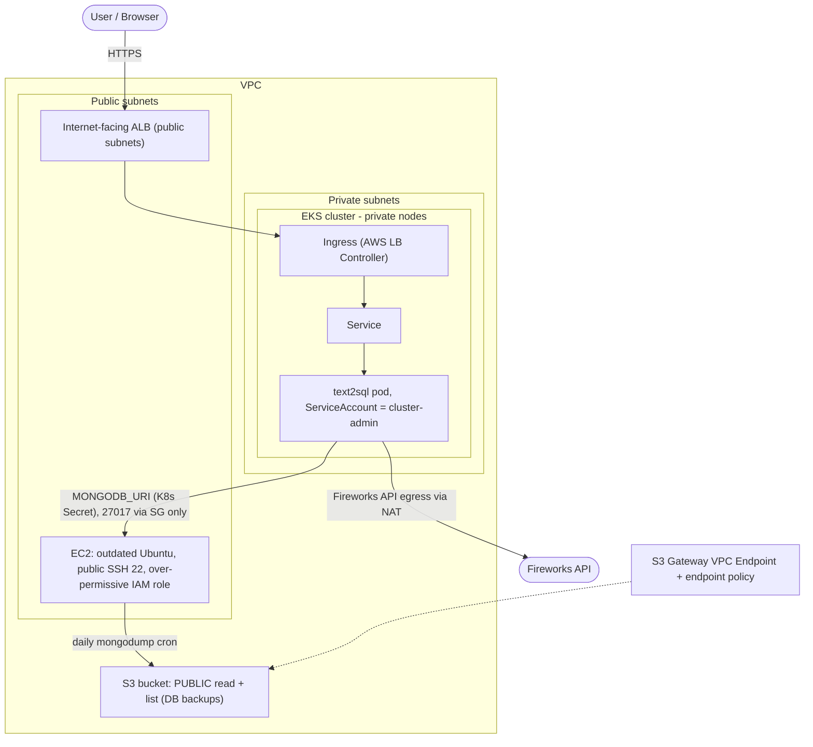

# Wiz Technical Exercise - Text-to-SQL on AWS

A two-tier, containerized **text-to-SQL agent** deployed to **AWS EKS**, backed by
**MongoDB** on an EC2 VM, built and shipped through two secured **CI/CD pipelines**,
and wrapped in native **AWS security controls**. The environment contains the
exercise's required *intentional* weaknesses - each one paired with a control that
detects or prevents it, so the whole build tells one attacker-vs-defender story.

> Name file requirement: [`wizexercise.txt`](wizexercise.txt) is baked into the image
> and validated in the running pod (see the demo script).

## The product (not just a demo app)

An interactive **text-to-SQL** web app: a user signs up, **uploads a `.db` (SQLite)
file**, and asks questions in natural language. The agent grounds every prompt in the
live database schema, returns a single **read-only** `SELECT`, self-corrects on error,
and renders the SQL + results. It genuinely uses **MongoDB** for users, the uploaded-DB
registry, and query history - which is also how we satisfy the exercise's "the app
must leverage MongoDB, with the connection string injected as a Kubernetes env var."

Two databases, two jobs:
- **MongoDB** (on the VM) = the app's own system-of-record (users, uploads, history).
- **SQLite** (uploaded per user) = the analytics target the agent queries.

## Architecture



## Repository layout

`⚠` marks the four files holding the intentional weaknesses.

```
app/                       the application
├── src/                   my original text-to-SQL agent, reused unchanged
│   ├── agent.py           ask the model for SQL, run it, self-correct
│   ├── schema.py          ground the prompt in the uploaded DB's real tables
│   ├── checker.py         THE SQL GUARD - one read-only SELECT, nothing else
│   ├── config.py          model choice, API key, failover
│   └── utils.py           shared helpers
├── web/                   the web layer I added
│   ├── main.py            every route
│   ├── mongo.py           MongoDB client: users, databases, history
│   ├── auth.py            bcrypt hashing + JWT session cookie
│   ├── storage.py         UPLOAD HARDENING - type, size, read-only, per-user
│   ├── agent_service.py   bridges web to agent, saves each turn
│   ├── settings.py        all config from environment variables
│   ├── templates/         login + console pages
│   └── static/            css, js
├── tests/                 21 tests proving the two guards above hold
├── Dockerfile             two-stage build, non-root, bakes in wizexercise.txt
└── requirements.txt       pinned dependency versions (the source of truth)

infra/                     Terraform - builds the cloud
│   SETUP (no resources; configures Terraform itself)
├── providers.tf           which cloud, which plugin versions
├── backend.tf             where state is stored
├── variables.tf           every adjustable setting
├── locals.tf              computed names and tags
├── outputs.tf             values printed after apply
├── exercise.auto.tfvars   this deployment's settings (shared with CI)
│   ENVIRONMENT
├── vpc.tf                 3 AZs, public + private subnets, NAT, S3 endpoint
├── eks.tf                 the cluster: private nodes, all audit logs
├── ecr.tf                 container registry
├── mongo_vm.tf         ⚠  the DB machine, its firewall, its IAM role
├── user_data.sh.tpl    ⚠  what installs on the machine at first boot
├── s3_backups.tf       ⚠  the public backup bucket
├── iam.tf              ⚠  the admin VM role + the keyless CI role
│   CONTROLS
├── cloudtrail.tf          records every API call
├── config.tf              3 detective rules
├── guardduty.tf           threat detection
└── bootstrap-addons.sh    post-apply: load balancer controller + Kyverno

k8s/                       everything kubectl applies
├── namespace.yaml         the text2sql namespace
├── serviceaccount.yaml    the app's identity in the cluster
├── clusterrolebinding.yaml   ⚠ binds that identity to cluster-admin
├── deployment.yaml        2 pods, hardened, Mongo URI from a Secret
├── service.yaml           stable internal address
├── ingress.yaml           requests the internet-facing ALB
├── kustomization.yaml     ties the manifests together
└── policies/              PREVENTATIVE CONTROL (Kyverno, enforce mode)

security/                  proving the controls work
└── README.md              four-layer test matrix: each weakness and what catches it

.github/
├── workflows/infra.yml    pipeline 1: scan the Terraform, then apply
├── workflows/app.yml      pipeline 2: test, scan, build, deploy
├── branch-protection.json required checks + code-owner review on main
├── CODEOWNERS             who must review which folder
└── dependabot.yml         weekly dependency and action updates

scripts/
├── deploy-app.sh          renders the image digest, creates the Secret, applies
└── setup-github.sh        creates the repo with its security settings

docs/OVERVIEW.md           design decisions, attack path, requirements, findings
wizexercise.txt            my name - baked into the image
```

## Intentional weaknesses (required) and the control that catches each

- **Public-readable + listable S3 bucket** holding DB backups -> AWS Config
  `s3-bucket-public-read-prohibited` (detective) + `tfsec`/`checkov` flag it pre-deploy.
- **EC2 VM with SSH open to `0.0.0.0/0`** -> AWS Config `restricted-ssh` + GuardDuty
  `SSHBruteForce` (detective); caught by IaC scan pre-deploy.
- **Over-permissive VM instance role** (admin) -> CloudTrail + GuardDuty on anomalous
  use; IaC scan flags the wildcard policy.
- **Outdated Linux + outdated MongoDB** -> image/host CVEs; the story's "keeping up with
  security news" thread.
- **Container runs as cluster-admin** -> Kyverno preventative policy demonstrates
  blocking the *class* of risk on new workloads; RBAC review in the demo.

See [`docs/OVERVIEW.md`](docs/OVERVIEW.md) for the design decisions, attack path,
requirements mapping and scanner findings.

## Quick start (local)

```bash
cd app
cp .env.example .env            # set FIREWORKS_API_KEY; MONGODB_URI defaults to localhost
docker run -d -p 27017:27017 --name mongo mongo:7   # or any reachable MongoDB
pip install -e .                # or: uv pip install -e .
uvicorn web.main:app --reload --port 8080
# open http://localhost:8080  -> sign up -> upload data/Chinook.db -> ask a question
```

## Deploy (AWS)

Two pipelines do this in CI, but the manual path is:

```bash
cd infra
terraform init && terraform apply           # VPC, EKS, Mongo VM, S3, IAM, audit/detective controls
$(terraform output -raw configure_kubectl)  # point kubectl at the cluster
./bootstrap-addons.sh                       # AWS Load Balancer Controller + Kyverno policies
cd ..

# Build/push happens in CI; manually: push to ECR, then deploy by digest.
MONGODB_URI=$(terraform -chdir=infra output -raw mongodb_uri) \
APP_SECRET_KEY=$(openssl rand -hex 32) FIREWORKS_API_KEY=fw_... \
  scripts/deploy-app.sh <account>.dkr.ecr.us-east-1.amazonaws.com/text2sql-app@sha256:<digest>

kubectl -n text2sql exec deploy/text2sql -- cat /app/wizexercise.txt   # prove the name file
```

Design notes: [`docs/OVERVIEW.md`](docs/OVERVIEW.md).

> This environment is intentionally insecure for a security exercise. Do not deploy it
> in a production account or leave it running. Tear down with `terraform destroy`.
