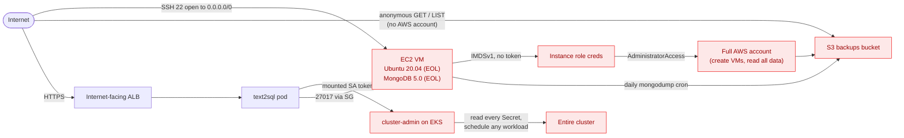

# Architecture & attack path

Two views of the same system. The **architecture** is what you build in Act 1; the
**attack path** is the same components re-read as an attacker in Act 2, which is the
exact graph a CNAPP like Wiz would surface. The network diagram lives in the
[README](../README.md#architecture); this doc adds the component inventory, the
trust boundaries, and the attack-path graph.

## Component inventory

| Layer | Component | Where | Notable config | Intentional? |
|---|---|---|---|---|
| Edge | Internet-facing ALB | Public subnets | Provisioned from the Ingress by the AWS LB Controller | no |
| Compute | EKS cluster `text2sql-eks` | Private subnets | k8s 1.29, managed node group (t3.medium x2), public API endpoint, all 5 control-plane log types on | no |
| App | `text2sql` pod | EKS | Non-root, read-only rootfs, caps dropped — but SA is **cluster-admin** | SA binding **yes** |
| Data (app) | MongoDB 5.0 | EC2 VM (public subnet) | Auth on; `bindIp 0.0.0.0`; reachable on 27017 only from the EKS node SG | version EOL **yes** |
| Data (analytics) | Uploaded SQLite `.db` | Pod `emptyDir` | Opened read-only, `query_only`, extensions off, wall-clock timeout | hardened (no) |
| Host | Ubuntu 20.04 "focal" VM | Public subnet | SSH 22 open to `0.0.0.0/0`; IMDSv1 allowed; **AdministratorAccess** instance role | all **yes** |
| Backup | S3 bucket | Regional | **Public read + list**; daily `mongodump` cron writes `backups/mongo-*.archive.gz` | public **yes** |
| Registry | ECR repo `text2sql-app` | Regional | Scan-on-push; immutable-ish deploy by digest | no |
| Network | S3 gateway VPC endpoint | VPC | Endpoint **policy** scoped to the backup bucket + a platform read-through | no |
| Identity | GitHub Actions OIDC role | IAM | Keyless CI; trust scoped to `repo:<owner>/<repo>:*`; EKS access entry = cluster admin | no |

## Trust boundaries (where the interesting failures live)

1. **Internet → ALB → pod.** The only intended ingress. The pod is reachable from
   the internet, which is why its cluster-admin ServiceAccount is the scariest knob.
2. **Internet → VM:22.** SSH open to the world is the front door of the host attack
   path. Port 27017 is *not* crossing this boundary — the SG only admits the EKS
   nodes — so the DB is "private-ish" while the host is wide open.
3. **VM → IMDS → IAM.** Inside the host, IMDSv1 hands any local process the admin
   role credentials. This is the privilege-escalation hinge.
4. **VM → S3 (cron) and Internet → S3 (anonymous).** Backups cross from a
   compromised host into a bucket the whole internet can read. Exfil without even
   needing the stolen role.
5. **Pod → k8s API.** The mounted SA token crosses into the control plane as
   cluster-admin: read every Secret, schedule anything.

## Attack path (the CNAPP graph)

Two internet entry points (the VM's SSH and the app's ALB) each lead, in two or
three hops, to total compromise of either the AWS account or the Kubernetes
cluster — and both converge on the **same** world-readable bucket of database
backups. That convergence is the point: these are not five unrelated findings, they
are one attack path, and prioritizing by path (not by CVSS list) is the CNAPP pitch.

## Requirement → implementation traceability

See [`REQUIREMENTS.md`](REQUIREMENTS.md) for the line-by-line checklist mapping each
exercise requirement to the file that satisfies it.
