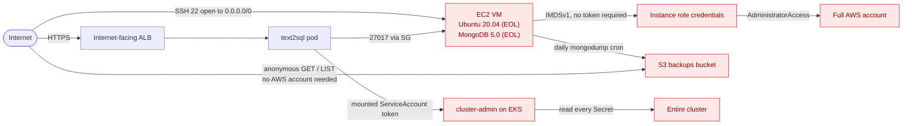

# Design notes

My notes on what I built, why I built it this way, and what the security tooling
found. The network diagram is in the [README](../README.md#architecture).

## The decisions that shaped everything

**I used my own app instead of the sample todo list.** The exercise allows any app
as long as it uses MongoDB. I had already written a text-to-SQL agent, so I used
that. It gave me a real product to talk about and three security surfaces a todo
list doesn't have: untrusted `.db` uploads, LLM-generated SQL, and prompt injection.
The cost was real — it had no web tier and no MongoDB, so I had to build both.

**That forced a two-database design.** The agent queries SQLite, because that's what
users upload. So MongoDB became the system of record: accounts, the upload registry,
and query history. MongoDB owns identity and state; SQLite is the thing being
queried. Without that split, MongoDB would be bolted on purely to satisfy the
requirement.

**MongoDB runs on a VM, not Atlas or DocumentDB.** The exercise requires it, and it
makes the attack path real — a host with public SSH holds the datastore and ships
backups to a public bucket.

**Terraform, not CloudFormation.** One language across AWS, Kubernetes, and the
GitHub OIDC trust, plus the community VPC/EKS modules and `plan` as a reviewable
diff. The trade-off I accepted is owning remote state and locking, which
CloudFormation manages for you.

**I enforce in the app layer where I can.** The SQL guard allows a single read-only
`SELECT`, so even a manipulated model can't write or delete. Uploads must be real
SQLite files, are size-capped, open read-only, and are isolated per user. None of
this was required; it's the part of the system I'd actually defend in production.

## Architecture

| Layer | Component | Notable config | Weak on purpose? |
|---|---|---|---|
| Edge | Internet-facing ALB | from the Ingress, via the AWS LB Controller | no |
| Compute | EKS `text2sql-eks` | k8s 1.33, nodes in private subnets, all 5 control-plane log types on | no |
| App | `text2sql` pod | non-root, read-only rootfs, caps dropped — but the ServiceAccount is **cluster-admin** | the binding, **yes** |
| App data | MongoDB 5.0 | auth required; 27017 reachable only from the EKS node SG | version EOL, **yes** |
| Query data | uploaded SQLite | read-only, `query_only`, extensions off, timeout | no, hardened |
| Host | Ubuntu 20.04 VM | SSH open to `0.0.0.0/0`, IMDSv1 allowed, **AdministratorAccess** role | **yes, all three** |
| Backup | S3 bucket | **public read + list**, daily `mongodump` cron | **yes** |
| Registry | ECR | scan-on-push, deploys pinned by digest | no |
| Identity | GitHub Actions OIDC role | keyless CI, trust scoped to this repo only | no |

Two settings on the VM point in opposite directions on purpose: SSH is wide open,
but Mongo's port only admits the cluster and demands a password. Both are required.

## Attack path

There are two internet entry points — the VM's SSH port and the app's load balancer
— and each reaches total compromise of either the AWS account or the cluster in two
or three hops. Both converge on the same world-readable bucket.

That convergence is the whole point. These aren't five unrelated findings; they're
one path. The backups in that bucket contain the `users` collection, so the payload
at the end of the chain is my user table — emails and bcrypt password hashes.

## Requirements

| Requirement | Where | How I prove it |
|---|---|---|
| Containerized app, image I built | `app/Dockerfile` | the ALB URL serves it |
| App uses MongoDB | `app/web/mongo.py` | `mongosh` shows the documents |
| Mongo URI as a K8s env var | `k8s/deployment.yaml` → Secret | `kubectl exec ... printenv MONGODB_URI` |
| `wizexercise.txt` with my name | `app/Dockerfile` `COPY` | `kubectl exec ... cat /app/wizexercise.txt` |
| DB on a VM, outdated version | `infra/mongo_vm.tf`, `user_data.sh.tpl` | `mongod --version` → 5.0.34 |
| Outdated OS | Ubuntu 20.04 AMI | `lsb_release -d` |
| SSH open to the internet | `mongo_vm.tf` SG | Config rule `restricted-ssh` |
| Over-permissive VM role | `infra/iam.tf` | `03_imds_role_theft.sh` |
| Mongo restricted to the cluster + auth | `mongo_vm.tf`, `user_data.sh.tpl` | unauthenticated query is refused |
| Daily backup to object storage | `user_data.sh.tpl` cron | objects in the bucket |
| Bucket public read + list | `infra/s3_backups.tf` | `aws s3 ls --no-sign-request` |
| EKS nodes in private subnets | `infra/eks.tf` | `kubectl get nodes -o wide`, no public IPs |
| Container has cluster-admin | `k8s/clusterrolebinding.yaml` | `04_pod_cluster_admin.sh` |
| Exposed via Ingress + cloud LB | `k8s/ingress.yaml` | the public ALB hostname |
| Code in a VCS | GitHub | the repo |
| Pipeline 1 — deploy IaC | `.github/workflows/infra.yml` | green run |
| Pipeline 2 — build image, deploy to k8s | `.github/workflows/app.yml` | green run |
| Repo security controls | branch protection, secret scanning, Dependabot | repo settings |
| Scan IaC before deploy | tfsec + checkov in `infra.yml` | 41 alerts in the Security tab |
| Scan image before deploy | Trivy gate in `app.yml` | it blocked a deploy once |
| Control-plane audit logging | `infra/cloudtrail.tf`, `infra/eks.tf` | CloudTrail + EKS log group |
| Preventative control | Kyverno, enforce mode | a privileged pod is denied live |
| Detective control | `infra/config.tf`, `infra/guardduty.tf` | 3/3 rules NON_COMPLIANT, GuardDuty sev 8.0 |

## What the scanners found

Checkov reports **41 findings** on the Terraform, published to the repo's Security
tab. They sort into three groups, and the split matters more than the number.

**About nine are the weaknesses I planted.** The public bucket alone accounts for
five of them, because checkov checks public ACLs, public policy, ignore-ACLs,
restrict-public and the access block as five separate rules. One decision, five
findings.

| My weakness | Check |
|---|---|
| SSH open to the internet | `CKV_AWS_24` |
| VM has AdministratorAccess | `CKV_AWS_274` |
| VM has a public IP | `CKV_AWS_88` |
| IMDSv1 enabled | `CKV_AWS_79` |
| Public bucket | `CKV2_AWS_6`, `CKV_AWS_53/54/55/56` |

**About thirty are generic best-practice findings** unrelated to this exercise —
S3 lifecycle rules, event notifications, cross-region replication, customer-managed
KMS keys, access logging, EBS optimisation, mutable ECR tags.

**Three of my six deliberate weaknesses don't appear at all**, and this is the part
I find most useful. Checkov can't tell that an AMI is a year old. It can't read what
a bootstrap shell script installs, so it never sees MongoDB 5.0. And I scoped the
scan to `infra/`, so it never looked at the Kubernetes manifests where the
cluster-admin binding lives.

That's why I didn't stop at shift-left. A file scanner only sees files, only where
you point it, and only what it has rules for. Config, GuardDuty and CloudTrail catch
what it structurally cannot — including changes that never go through CI at all. I
applied Terraform locally several times while debugging; those applies skipped the
pipeline entirely, and the runtime controls flagged the public bucket anyway.

**Why the IaC scanners don't block.** The exercise requires these misconfigurations
to reach production, so tfsec and checkov are `soft_fail` — they report. The
container scanner enforces, because container vulnerabilities aren't required. That
asymmetry is deliberate: I enforce where I can and report where I must.

## Known limitations

Things I'd fix next, in order of how much they'd bother me in production.

- **Uploads live on each pod's `emptyDir`.** With two replicas, an upload and the
  follow-up query can land on different pods. I mitigated it with ALB session
  affinity, but a pod restart still loses that user's file. The real fix is shared
  storage — S3, EFS, or the blob in MongoDB via GridFS.
- **Terraform modules are pinned by version, not commit hash** (`CKV_TF_1`). I
  pinned every GitHub Action to a full SHA but left the community modules on version
  tags. Same supply-chain risk, different layer. The scanner taught me that one.
- **The boot script is write-once.** Editing `user_data.sh.tpl` updates the instance
  attribute but never re-runs, because boot scripts only execute at first boot.
  Configuration management or a pre-baked image would be the right tool.
- **Kyverno policies aren't under CI/CD.** They're applied by
  `infra/bootstrap-addons.sh` by hand, so my one preventative control is the single
  security component a pipeline doesn't deploy.
- **ECR basic scanning returns `UNSUPPORTED_IMAGE`** for Debian 12, so image
  scanning is effectively done by Trivy in the pipeline rather than natively.
  Amazon Inspector would cover it.
- **Hardening backlog from the scan:** KMS CMKs for S3/ECR/CloudTrail, immutable
  ECR tags, CloudTrail to CloudWatch Logs, S3 access logging and lifecycle rules,
  tighter security-group egress.
